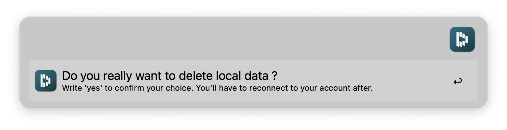

[](https://github.com/BenjaminOddou)
[](https://saythanks.io/to/BenjaminOddou)
[](https://www.python.org/downloads/macos/)

Welcome to the Alfred Dashlane repository: **An Alfred Workflow** ✨

## ✅ Prerequisites

* macOS.
* Alfred 5. Note that the [Alfred Powerpack](https://www.alfredapp.com/powerpack/) is required to use workflows.
* A [Dashlane](https://www.dashlane.com/fr) account protected by a master password.
* **Python 3.9** or above (`python3 --version`).
* The [Dashlane CLI](https://github.com/Dashlane/dashlane-cli) (`dcli`), see below.

## 🏎️ Dashlane CLI

This workflow uses the [Dashlane CLI](https://github.com/Dashlane/dashlane-cli) provided by the [Dashlane team](https://github.com/Dashlane). Install it with [Homebrew](https://brew.sh) or [manually](https://dashlane.github.io/dashlane-cli/install):

```shell
brew install dashlane/tap/dashlane-cli
```

The workflow finds `dcli` in your `PATH`, `/opt/homebrew/bin`, `/usr/local/bin`, `~/.local/bin` or `~/bin`. Otherwise, set `🛠️ dcli path` in the configuration.

The CLI must keep its default `save-master-password` setting (`true`): the workflow relies on the CLI staying unlocked between two searches. If you want to know how the CLI stores data on your computer, check this [README](https://github.com/Dashlane/dashlane-cli/blob/master/src/modules/crypto/README.md).

This workflow can't add or edit items, and it handles one account at a time.

## ⬇️ Installation

1. [Download the workflow](https://github.com/BenjaminOddou/alfred-dashlane/releases/latest)
2. Double click the `.alfredworkflow` file to install
3. Fill `👤 Login` with the email of your Dashlane account

## 🧙‍♂️ Invoke the workflow

There are 2 flows in this workflow:

1. `pdash` displays all the credentials of your Dashlane vault.
2. `odash` displays the credentials that have an OTP (2FA code).

You can edit these triggers (flagged with a `🕹️` symbol) in the user configuration panel.

## 🤖 Usage of the workflow

### Setup variables

1. `👤 Login`: email of your Dashlane account. **It is required to start the workflow**.
2. `🫥 Incognito mode`: hide partially your logins in Alfred. If ticked:


if unticked:


3. `🔥 Allow cache`: keep the list of your items (titles, URLs and logins, **never passwords or OTP secrets**) in the workflow cache folder while the CLI is unlocked. The list shows instantly and is refreshed in the background. It is deleted as soon as the vault is locked, even when you lock it from the terminal.
4. `🧹 Clear clipboard`: erase a copied password / OTP from the clipboard after this delay (default 30 s).
5. `🛠️ dcli path`: only needed if the CLI isn't found automatically.

### Feedback

The workflow sends no notification. After an action (sync, lock, unlock, logout, device removal…), Alfred shows the list again with the result on the first line.

### Login

Press ⏎ on **Login to Dashlane**. A Dashlane page opens in your browser, then the workflow asks, in native macOS dialogs:

1. the token shown in the browser,
2. the 6-digit code received by email (or from your authenticator app),
3. your master password (hidden).

This Mac is then registered as a device of your account and your vault is synced.

### Get passwords and OTPs

Search an item by its title, its website or (when incognito is off) its login.

1. <kbd>↩︎</kbd> copy the password (`odash`: the OTP code).
2. <kbd>⌘</kbd><kbd>↩︎</kbd> copy the login.
3. <kbd>⌥</kbd><kbd>↩︎</kbd> open the URL.
4. <kbd>⇧</kbd><kbd>↩︎</kbd> type login <kbd>⇥</kbd> password in the frontmost application (Alfred needs the *Accessibility* permission).
5. <kbd>⌃</kbd><kbd>↩︎</kbd> copy the OTP code (`pdash`, items with 2FA).

### Sync

❗ You need an internet connection.

Press ⏎ on **Sync** to download the latest changes of your vault. The CLI also syncs on its own once per hour.

### Lock / Unlock

**Lock** locks the CLI. **Unlock** asks your master password in a hidden dialog (plus a 2FA code if your account asks for it at every login).

### Download favicons

❗ You need an internet connection.

Downloads the missing icons of your websites in the background, 8 at a time, in the workflow cache folder (`~/Library/Caches/com.runningwithcrayons.Alfred/Workflow Data/com.benjamino.dashlane`). ⚠️ The domains of your accounts are sent to Google's favicon service.

### Manage connected devices

Press <kbd>⌘</kbd><kbd>↩︎</kbd> on a device to remove it. You can also remove all devices (including this Mac, which logs you out) or the other devices. Bulk actions need a typed `yes`.


### Logout

Logs the CLI out (this Mac is revoked from your devices) and erases the local data, favicons included. Confirm by typing `yes`.



## 🔐 Security

* The master password, the browser token and the codes are typed in native macOS dialogs (hidden for the password) and sent to `dcli` through its terminal. They never go through Alfred's bar, a command line or an environment variable.
* Passwords and OTP codes are read one at a time with `dcli read` when you action an item, and never written to disk.
* The optional list cache holds no secret, is readable by you only (`0600`) and only exists while the CLI is unlocked, when any program running as you could ask the CLI for the whole vault anyway.
* Copied secrets are marked transient (ignored by clipboard history managers) and erased after the chosen delay, only if the clipboard still holds them.
* ⇧⏎ sends its AppleScript through stdin with escaped strings: the password never appears in a process list and can't inject AppleScript.
* Only `http(s)` URLs are opened.
* Bundled libraries are pure Python (`pexpect`, `ptyprocess`, `certifi`): no binary, nothing downloaded at runtime.

## 🧪 Development

```shell
python3 -m unittest discover -s tests
```

The tests drive the workflow against `tests/fake_dcli.py`, a stand-in that asks the same questions as the real CLI through a real pty. `update.sh` refreshes the bundled libraries.

## ⚖️ License

[MIT License](LICENSE) © Benjamin Oddou
