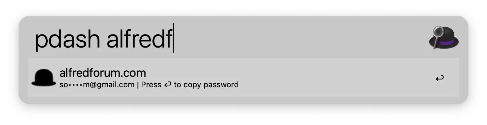
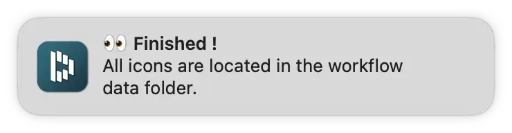
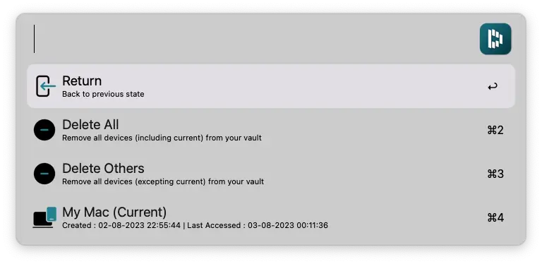

[](https://github.com/BenjaminOddou)
[](https://saythanks.io/to/BenjaminOddou)
[](https://www.python.org/downloads/macos/)

Welcome to the Alfred Dashlane repository: **An Alfred Workflow** ✨

## ✅ Prerequisites

* macOS.
* Alfred 5. Note that the [Alfred Powerpack](https://www.alfredapp.com/powerpack/) is required to use workflows.
* A [Dashlane](https://www.dashlane.com/fr) account protected by a **master password** (SSO and passwordless accounts are not supported).
* **Python 3.9 to 3.15** (`python3 --version`), Apple Silicon or Intel. The Apple one (Xcode Command Line Tools), python.org and Homebrew builds all work.

Since v2.0.0 the workflow **no longer needs the Dashlane CLI**: it talks to the Dashlane API directly, in Python. Everything it needs ships inside the workflow, nothing is downloaded or installed at runtime.

## ⬇️ Installation

1. [Download the workflow](https://github.com/BenjaminOddou/alfred-dashlane/releases/latest)
2. Double click the `.alfredworkflow` file to install
3. Fill `👤 Login` with the email of your Dashlane account

## 🧰 First run

1. Type `pdash`, then press ⏎ on **Login to Dashlane**. A Dashlane page opens in your browser:
   1. paste the token shown in the browser,
   2. enter the 6-digit code received by email (or from your authenticator app),
   3. enter your master password.

   All three are asked in native macOS dialogs (the master password one is hidden). This Mac is registered as a new device of your account (`Alfred - <computer name>`), then your vault is downloaded and decrypted.

> If you used v1, you can uninstall the Dashlane CLI (`dcli logout` first if you want to revoke its device). The plaintext JSON cache of v1 is deleted on the first run.

## 🧙‍♂️ Invoke the workflow

There are 2 flows in this workflow:

1. `pdash` displays all the credentials of your Dashlane vault.
2. `odash` displays the credentials that have an OTP (2FA code).

You can edit these triggers (flagged with a `🕹️` symbol) in the user configuration panel.

## 🤖 Usage of the workflow

### Setup variables

1. `👤 Login`: email of your Dashlane account. **It is required to start the workflow**.
2. `🫥 Incognito mode`: hide partially your logins in Alfred. If ticked:



if unticked:


3. `🔒 Auto-lock`: lock the vault after this much inactivity (default 1 hour).
4. `🧹 Clear clipboard`: erase a copied password / OTP from the clipboard after this delay (default 30 s).
5. `🔄 Background sync`: refresh the vault in the background when it is older than this (default 1 hour).
6. `🎷 Notification sound`: sound of the workflow notifications.

### Get passwords and OTPs

Search an item by its title, its website or (when incognito is off) its login.

1. <kbd>↩︎</kbd> copy the password (`odash`: the OTP code).
2. <kbd>⌘</kbd><kbd>↩︎</kbd> copy the login.
3. <kbd>⌥</kbd><kbd>↩︎</kbd> open the URL.
4. <kbd>⇧</kbd><kbd>↩︎</kbd> type login <kbd>⇥</kbd> password in the frontmost application (Alfred needs the *Accessibility* permission).
5. <kbd>⌃</kbd><kbd>↩︎</kbd> copy the OTP code (`pdash`, items with 2FA).

### Lock / Unlock

**Lock** removes the vault key from your keychain. **Unlock** asks your master password in a hidden dialog (plus a 2FA code if your account asks for it at every login). Unlocking works offline, except for accounts with 2FA at every login.

### Sync

Press ⏎ on **Sync** to refresh your vault now. It is also refreshed in the background (see `🔄 Background sync`). You need an internet connection.

### Download favicons

Downloads the missing icons of your websites, 8 at a time, in the workflow cache folder. ⚠️ The domains of your accounts are sent to Google's favicon service.



### Manage connected devices

Press <kbd>⌘</kbd><kbd>↩︎</kbd> on a device to remove it. You can also remove all devices (including this Mac, which logs you out) or the other devices. Bulk actions need a typed `yes`.



### Logout

Revokes this Mac from your Dashlane devices and erases all local data. Confirm by typing `yes`.


## 🔐 Security model

| | |
|---|---|
| Master password | Typed only in a native hidden macOS dialog, read through a pipe. Never in Alfred's bar, a command line, an environment variable or a file. |
| Login | Device registration with the browser token + email / 2FA code, then [OPAQUE](https://www.rfc-editor.org/rfc/rfc9807) proof of the master password (the password never leaves your Mac). Dashlane's OPAQUE server key is pinned. |
| API calls | HTTPS (TLS ≥ 1.2, certificates verified), every request signed with HMAC-SHA256 device keys. |
| Data at rest | `state.json` (no secret) + `index.bin` / `secrets.bin` encrypted with AES-256-GCM. Only credentials are kept, with the fields the workflow uses. Files are `0600`, the folder `0700`. |
| Vault key | Random 256-bit key, wrapped with Argon2id (64 MiB, 3 passes) of your master password. While unlocked it sits in the macOS login keychain; locking (manual or auto-lock) deletes it. |
| Clipboard | Copies are marked transient (ignored by clipboard history managers) and erased after the chosen delay, only if the clipboard still holds the secret. |
| Typing | ⇧⏎ sends the AppleScript through stdin, with escaped strings: the password is never in a process argument list. |
| Dependencies | Pure Python, plus [`cryptography`](https://pypi.org/project/cryptography/) 48.0.1 (Argon2 + AES) and `certifi`, bundled in `src/lib`. They come from the official PyPI wheels, checked against pinned SHA-256 by [`vendor.py`](vendor.py). Nothing is downloaded at runtime. |

Limits: anything running as your macOS user while the vault is unlocked can ask `security` for the vault key, like with the Dashlane CLI. Keep the auto-lock short if this matters to you.

The workflow uses the protocol and the public API keys of the open-source [Dashlane CLI](https://github.com/Dashlane/dashlane-cli) (Apache-2.0). It is read-only: it can't add or edit items, and it handles one account at a time.

## 🧪 Development

```shell
python3 -m pip install cryptography
python3 -m unittest discover -s tests
```

On macOS the tests use the bundled packages; elsewhere they use the `cryptography` of your environment. `tests/test_workflow.py` runs the whole workflow against a fake Dashlane server. Set `DLW_NODE_MODULES` to a folder with `@serenity-kit/opaque@1.1.0` to also check the OPAQUE client against the library the Dashlane CLI uses.

### Bundled packages

`src/lib` holds `certifi`, `cryptography` (universal2, stable ABI: one copy for every Python ≥ 3.9) and `_cffi/<arch>/_cffi_backend.cpython-3XY-darwin.so`, the only part of `cffi` that `cryptography` loads, for Python 3.9 to 3.15 on arm64 and x86_64 (about 27 MB). To upgrade, edit the wheel names and SHA-256 in [`vendor.py`](vendor.py) and run `./update.sh`: it downloads the wheels from PyPI, refuses any hash mismatch, re-extracts `src/lib` and runs the tests.

## ⚖️ License

[MIT License](LICENSE) © Benjamin Oddou
